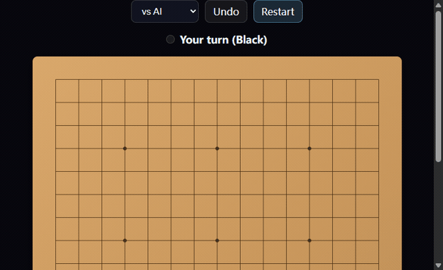

# Gomoku

Classic five-in-a-row with AI opponent



## Run it

Open `index.html` in any modern browser — no build, no install, no dependencies.

```bash
# just open it
open index.html
```

## How it works

The board is a 2D array; every move checks the four directions for five-in-a-row before the AI answers.

The full implementation, controls and edge cases live on the live site — the snippet above is the core idea only.

## Live version

▶ **Try it on FunBox:** https://funboxs.top/en/games/board/gomoku/

## More from FunBox

A hand-picked selection of related tools — each one links straight to the live site:

- [Pac-Man](https://funboxs.top/en/games/arcade/pac-man/) — Classic maze chase: eat the dots and dodge the ghosts
- [Tetris](https://funboxs.top/en/games/arcade/tetris/) — Classic Tetris game
- [Snake](https://funboxs.top/en/games/arcade/snake/) — Classic Snake game
- [Paper Plane](https://funboxs.top/en/games/arcade/flappy-bird/) — Tap to control paper plane through pipes
- [Robot Run](https://funboxs.top/en/games/arcade/dino-run/) — Original endless runner game, jump to avoid obstacles
- [Break Bricks](https://funboxs.top/en/games/arcade/break-bricks/) — Classic brick breaker game with paddle and ball
- [Bubble Shooter](https://funboxs.top/en/games/puzzle/bubble-shooter/) — Aim and pop groups of three same-color bubbles
- [Match 3](https://funboxs.top/en/games/puzzle/match-3/) — Swap candies, match three, chain for big scores
- [Watermelon Merge](https://funboxs.top/en/games/puzzle/watermelon-merge/) — Merge identical fruits into a big watermelon
- [Sudoku](https://funboxs.top/en/games/logic/sudoku/) — Classic Sudoku with three difficulties and unique solutions
- [Minesweeper](https://funboxs.top/en/games/logic/minesweeper/) — Classic minesweeper game, left click to reveal, right click to flag
- [3D Rubik’s Cube](https://funboxs.top/en/games/logic/rubik-cube/) — A pure front-end 3D Rubik’s cube: orbit, turn faces and solve it
- [Chess](https://funboxs.top/en/games/board/chess/) — Play full-rule chess against an AI with check and mate
- [Gomoku](https://funboxs.top/en/games/board/gomoku/) — Classic five-in-a-row with AI opponent
- [Billiards](https://funboxs.top/en/games/sports/billiards/) — Drag to aim and clear the table in the fewest shots
- [Cut the Rope](https://funboxs.top/en/games/sports/cut-rope/) — Slice the ropes to swing the candy into the mouth while grabbing all three stars.
- [Angry Birds](https://funboxs.top/en/games/action/angry-birds/) — Pull back the slingshot to launch birds, topple the crates and squash every green pig.
- [Bubble Wrap](https://funboxs.top/en/games/casual/bubble-wrap/) — Online bubble wrap popping, stress relief

---

MIT licensed. Extracted from the FunBox site for showcase purposes.
